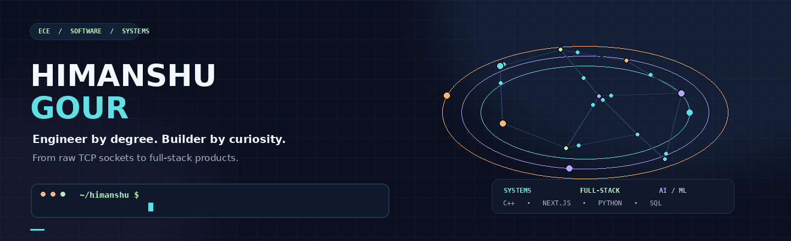
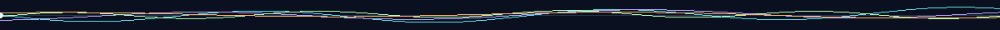
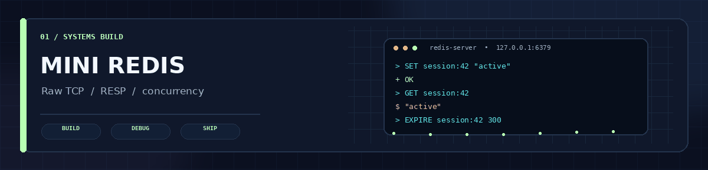
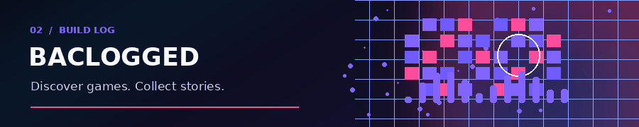
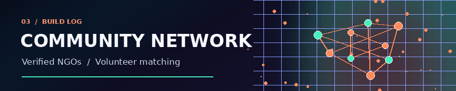
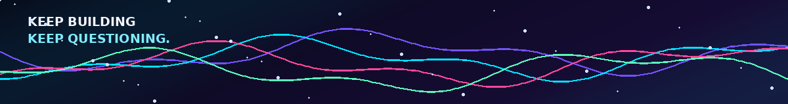

<em>A little signal in the noise — code, curiosity, and the joy of making things move.</em>

01 / The human behind the commits
Curiosity first. Abstractions later.

I'm Himanshu Gour — an Electronics & Communication Engineering student at MANIT Bhopal who likes knowing what happens underneath the interface. One day that means a Redis-compatible key-value store over raw TCP sockets; another day it's a full-stack product with authentication, payments, and moderation logic.

struct Himanshu {
    string college   = "MANIT Bhopal (B.Tech, ECE)";
    string role      = "Problem Setter @ Zenith Programming Club";
    string goal      = "Entry-level SDE";
    string loves     = "C++, systems programming, full-stack products";
    string learning  = "ML, NLP, Deep Learning, GenAI";
    int    dsa       = 800;  // and counting
};

01 — FOUNDATION	02 — PRACTICE	03 — COMMUNITY	04 — NEXT FRONTIER
🎓 MANIT Bhopal
B.Tech, ECE
CGPA 8.25	🧩 800+ problems
LeetCode max rating 1818
Codeforces Pupil	🏆 Prometeo '26
Qualified for online round
IIT Jodhpur	🌱 ML · NLP · DL · GenAI
Currently learning
Target: SDE

- ✍️ Authoring and reviewing competitive programming problems at Zenith Programming Club.
- 💬 Ask me about C++, Python, systems programming, Next.js, PostgreSQL, and MongoDB.

02 / The toolbox

LANGUAGES — the raw materials

WEB — where ideas become usable

DATA & WORKFLOW — the machinery behind it

THE LEARNING LAB — currently exploring

FIELD	CURRENT KIT
Languages	C++, Python, JavaScript, TypeScript, SQL
Web	React.js, Next.js, Node.js, HTML, CSS, Tailwind CSS, REST APIs
Databases & Tools	PostgreSQL, MongoDB, Git, GitHub, Postman, Docker
ML / Data	Python, scikit-learn
Core CS	Data Structures & Algorithms, DBMS, Operating Systems, Computer Networks
Currently Learning	Machine Learning, NLP, Deep Learning, Generative AI

03 / The build wall

Three builds, three different ways to get closer to how software actually works.

<table>
<tr>
<td width="50%" valign="top">

⚡ Mini Redis
In-memory key-value store in C++17

A systems project focused on the layer beneath the client-facing features.
- Redis-compatible server using the RESP protocol over raw TCP sockets.
- Thread-per-connection concurrency with a mutex-guarded singleton database.
- 20+ commands across strings, lists, and hashes.
- TTL-based key expiration with lazy eviction.
- RDB-style persistence — snapshots every 300s, reload on startup.
C++17 · Sockets · Multithreading
</td>
<td width="50%" valign="top">

🎮 Baclogged
Game review & collection platform

A full-stack home for game discovery, reviews, and community features.
- MongoDB caching layer for the RAWG API — 50% fewer API calls and ~200 ms faster repeat searches.
- Razorpay integration with HMAC-SHA256 verification and idempotent callbacks.
- Role-based auth, moderation tooling, and a review-reporting pipeline.
- Two-stage AI avatar moderation (Gemini API + Cloudinary Rekognition).
React · Next.js · MongoDB · NextAuth
</td>
</tr>
<tr>
<td colspan="2" valign="top">

🤝 NGO Volunteer Management Platform
Connecting volunteers with verified NGOs

- Dual authentication — Better Auth for volunteers, custom JWT system for NGOs.
- Certificate verification with moderator approval before NGO account activation.
- Task-assignment logic that prevents volunteers from holding multiple active tasks.

Next.js · TypeScript · PostgreSQL · Better Auth

</td>
</tr>
</table>

04 / Currently in the lab

Moving from building software systems to exploring systems that learn.

05 / The telemetry

06 / Problem-solving log

07 / Open channel

Building toward an entry-level SDE role.
Open to SDE opportunities and cool collaborations — reach out anytime.

